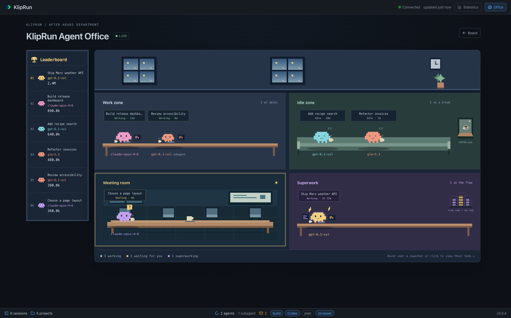
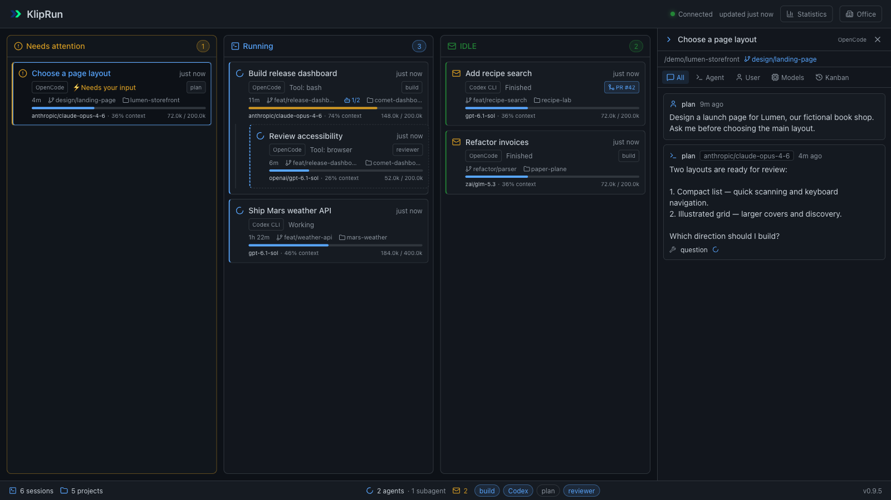
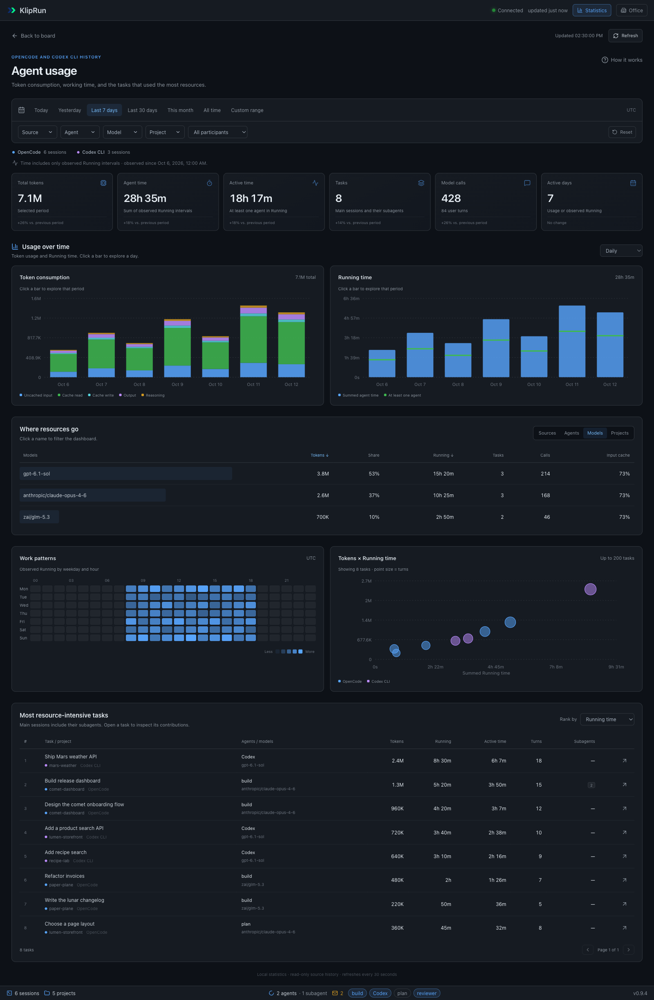

# KlipRun

[](https://bun.sh/)
[](https://www.typescriptlang.org/)
[](LICENSE)

**A local, read-only Kanban board for watching OpenCode and Codex CLI sessions.**
Live columns, context bars, usage statistics and a pixel-art agent office.
It never calls agent APIs and never changes session state: both agents'
databases are opened read-only.

## Preview

*All screenshots use fictional sessions, projects, messages and usage data.*

**Agent Office** — `/office`



**Kanban board** — `/`



**Usage statistics** — `/stats`



## Features

- Three columns: **Needs attention**, **Running**, **IDLE** — only sessions
  with an open TUI stay on the board (up to 20 directories).
- Cards show the current stage (`Tool: bash`, `Generating response`), elapsed
  time, git branch, MRs created by the session, subagent counts and a
  **context-window bar** with model name, percent used and tokens.
- Read/unread envelopes on idle cards; a details panel with messages, model
  usage and Kanban column history.
- **Statistics** (`/stats`): date, source, agent, model and project filters,
  token breakdowns, observed Running time, activity heatmaps and task rankings.
- **Agent Office** (`/office`): live pixel coworkers in Work, Idle and Superwork
  zones, with session names, models and status timers. Continuous Running over
  one hour unlocks Superwork. A token Leaderboard ranks current sessions by
  accumulated usage, counting each subagent separately without duplication.
  Short Idle transitions get a five-second grace period before coworkers move
  to the lounge; status labels stay live and questions or errors appear immediately.
  Seats stay fixed when neighbors move; an unknown status keeps the last known
  seat and displays a neutral label instead of implying that work finished.
  The desktop Leaderboard shows nine complete entries before scrolling.
  Coworkers waiting for input gather in a furnished **Meeting room** with an
  amber indicator. The empty room keeps its furniture and stable height.
  The four rooms use a compact 2×2 layout: Work and Idle above Meeting room
  and Superwork, with the same reading order on narrow screens.
- Live updates over Server-Sent Events (~100 ms) with ETag polling fallback.

## Quick start

Requires macOS, [Bun](https://bun.sh/) 1.4+ and OpenCode / Codex CLI sessions on disk.

```bash
bun install
bun run build          # build the web client
bun run start          # http://127.0.0.1:8792
```

Or run it as a command:

```bash
./scripts/kliprun install   # links kliprun-start/stop/status/restart/log into ~/.local/bin
kliprun-start               # → http://127.0.0.1:8792
kliprun-status              # health summary and board URL
kliprun-stop
```

`install` accepts a target directory: `./scripts/kliprun install ~/bin`.

Development:

```bash
bun run dev            # server with --watch on :8792
bun run dev:client     # Vite dev server on :5173, proxies /api → :8792
bun run test           # tests
bunx tsc -b            # typecheck
```

## How cards are classified

- **Needs attention** — the TUI is waiting for a permission or an answer.
- **Running** — a fresh user turn or a streaming response; silent for 15
  minutes means interrupted, not running.
- **IDLE** — finished, inactive or interrupted sessions left open in a TUI.

Codex cards share the same columns: terminal `codex` processes are matched to
sessions through open rollout/writer files or the shared app-server daemon
(`codex-tui` / `codex_hermes_monitor` originators). Ambiguous matches are
omitted, with reasons in `GET /api/health` → `codex_diagnostics`.
Cards, details and statistics use the current Codex session name when present;
otherwise they show the original title.

Codex approvals and answer selections also use fresh local codex-hermes
statuses for these matched sessions. KlipRun reads `watcher.json` and session
files from `~/.cache/codex-hermes` (`CODEX_HERMES_BASE_DIR` overrides it).
Without a valid, fresh Hermes status, classification uses the journal;
approvals inside tool wrappers may then be unavailable. Codex APIs are never
called, and waiting time is excluded from observed Running statistics.

## Configuration

| Variable | Purpose | Default |
|---|---|---|
| `KLIPRUN_BUN_PORT` | Web server port (`--port` flag wins) | `8792` |
| `KLIPRUN_BUN_DB` | OpenCode database (read-only) | `~/.local/share/opencode/opencode.db` |
| `KLIPRUN_BUN_HOME` | KlipRun state: history, usage index, logs | `~/.kliprun_bun` |
| `KLIPRUN_BUN_MODELS` | Model catalog for context limits | `~/.cache/opencode/models.json` |
| `KLIPRUN_BUN_CODEX_HOME` | Codex data directory (read-only) | `$CODEX_HOME` or `~/.codex` |
| `CODEX_HERMES_BASE_DIR` | Codex Hermes status directory (read-only) | `~/.cache/codex-hermes` |

## Statistics notes

Work time means **observed Running only**, sampled every 3 s while the server
runs — attention, IDLE and downtime are excluded. Tokens are recorded request
usage, normalized without double counting; costs appear only when the source
recorded them. History imports run in bounded chunks with durable checkpoints;
the local usage index stores no prompts or tool text.

## API

`GET /api/health` · `GET /api/board` (ETag/304) · `GET /api/stream` (SSE) ·
`GET /api/session/:id` · `GET /api/stats` · `GET /api/stats/sessions` ·
`GET /api/stats/session/:id` · `GET /api/stats/office-usage?session=:id`

Office usage accepts up to 50 repeated `session` parameters per request. It
reads all-history totals from the local Statistics index and marks partial
data; it does not substitute context-window tokens for accumulated usage.

## Safety and privacy

The web server binds to `127.0.0.1` only. OpenCode and Codex storage is opened
read-only and never written; KlipRun does not create sessions, send prompts or
approve permissions. Potential secrets are filtered before session details
reach the browser.

## License

[MIT](LICENSE)
